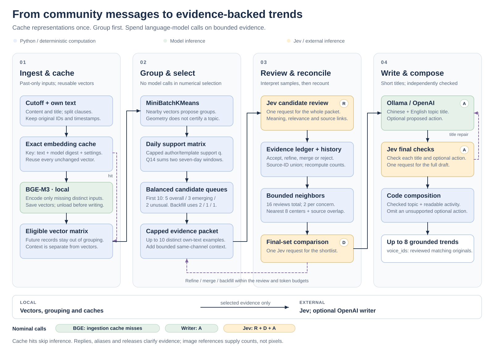
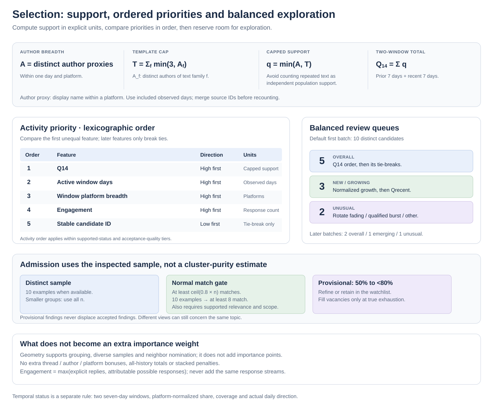
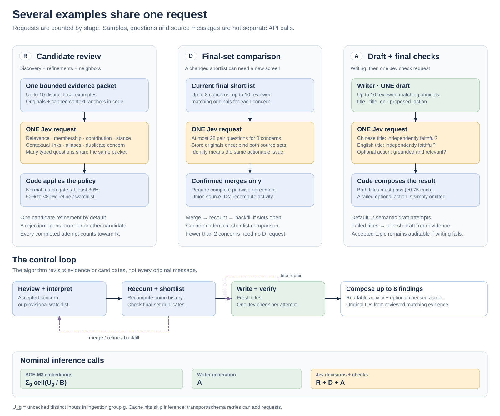

# Architecture

[Algorithms](ALGORITHMS.md) · [Setup](../README.md) · [Evaluation](EVALUATION.md)

## 1. Model roles and boundaries

An **original source** is one input message. Its **focal text** is the own-text contribution selected for review. A **packet** bundles selected originals, their focal texts and bounded context. A **source anchor** is an original and its focal text used to illustrate a proposed topic.

| Component | Owns | Input | Output |
| --- | --- | --- | --- |
| **BGE-M3, local ingestion** | Reusable text representations | Distinct substantive clauses from the author's own content/title | Cached, normalized 1,024-dimensional vectors |
| **Jev, external** | Semantic decisions | Selected originals, focal texts and bounded context | Relevance, membership, contribution roles, duplicate links and final wording decisions |
| **Writer: Ollama or OpenAI Responses API** | Topic summarization and bilingual wording | Reviewed matching originals and their associated context | Chinese title, English title and one proposed action |
| **Python** | Deterministic policy and arithmetic | Eligible records, vectors and decision ledgers | Selection order, source unions, histories, dates, evidence IDs, category and public explanation |

Clustering proposes groups. A cluster can contain several topics, and one topic can span several clusters. Neither cluster membership nor geometric closeness automatically makes a source an output citation.

The writer box uses the selected provider; Ollama with `qwen3:8b` is the default. The optional OpenAI writer uses the same evidence, prompts and final checks. It reads previously computed BGE vectors from the local cache and makes no Ollama calls.

## 2. Ingest once; select by cutoff

1. Preserve original IDs, own text, titles, timestamps, channels, platforms and parent relationships.
2. Normalize annotation syntax. Preserve readable emoji cues; exclude image-placeholder words and numeric emoji IDs from encoder inputs. Readable short contributions survive; recognized greetings, pure reactions and unavailable-media-only bodies do not establish independent topical text.
3. Split own text into qualifying clauses. Deduplicate encoder inputs while retaining every original occurrence for date/activity measurements. A text-family key identifies duplicated own content/title, not a semantic topic.
4. During live ingestion or local-provider runs, encode only missing inputs. The SQLite key includes exact encoder input, model digest and representation settings. CPU/GPU placement does not invalidate the vector.
5. Save and validate vectors and the encoder profile, then unload BGE before writing. Residency windows bound continuous loading; batches bound individual embedding requests.
6. At each requested date, restrict grouping, statistics, aliases, releases and context to eligible records. A future item's cached vector cannot supply future centroids, counts or interpretation to an earlier run.

The supplied [embedding bundle](../embeddings/README.md) restores vectors and their encoder profile without chats or semantic decisions. Local-provider runs and ingestion require Ollama; cache hits avoid BGE inference and loading.

OpenAI-provider runs use cache-only embeddings, including during `--prepare-only`. They validate the stored encoder name, digest, semantic options, width and every required vector before opening Jev or OpenAI services. They pin the recorded revision without querying current model tags. A missing profile, cache miss or invalid vector stops with `embedding_cache_error` and exit code 2; there is no live-inference fallback. See the bundle guide for restoring older caches or conflicting profiles.

Matching K-means snapshots are reused. Changed eligible inputs require regrouping, while unchanged text keeps its vector. Grouping uses a vector matrix and does not require a vector-search database.

## 3. Group and choose what deserves review

A **base candidate** is a cluster or a discussion-burst nomination. MiniBatchKMeans targets 80 distinct encoder inputs per cluster, within 8-384 cluster bounds. Fewer than eight inputs receive one cluster per input. These are computational limits, not promises of balanced or semantically pure groups.

The numerical stage builds a **day x platform support matrix**. Its primary score is the smaller of author breadth and template-capped support, summed over two comparison weeks. Active days, platform breadth and engagement break ties in that order.

The default first batch reserves five overall positions, three additional new/growing positions and two unusual positions. Later four-candidate batches use 2/1/1. A candidate cannot occupy two positions; empty queues backfill. These are review allocations, not final-output quotas.

Geometry guides clustering, varied sampling and neighbor nomination. Uniformity, inactive gaps, cosine similarity and attachment counts remain diagnostics rather than importance weights.

## 4. Review an evidence packet

Each selected candidate supplies up to ten examples, with distinct original IDs and focal texts. Sampling includes central, earliest/latest and boundary examples, then platform variety and reproducible additional coverage.

**All examples in one packet share one logical Jev request.** This is one **review attempt**. Refinement or review of a related neighbor adds another attempt; an attempt count is not a count of distinct base candidates. Code selects one or two source anchors. Jev judges their topics, studio relevance, membership, contribution roles, stance, context, aliases and duplicates.

| Decision | Default policy | Result |
| --- | --- | --- |
| Normal acceptance | Relevant, supported scope and at least `ceil(0.8 x n)` matching targets | Eight matches when ten are reviewed |
| Provisional | Relevant, supported scope and at least 50% but below 80% matching targets | Five to seven matches out of ten; refine or retain for exhausted-search fallback |
| Weak interpretation | At most 20% matches, or irrelevant/background | Reject this interpretation |
| Other mixed interpretation | Insufficient normal/provisional support | One bounded refinement can inspect new examples |

Disagreement can match the same topic. Unrelated examples are excluded from evidence without automatically rejecting the group. Judgments remain attached to focal texts and reduce to one membership vote per original. Refinement and merges can accumulate more than ten reviewed originals for a topic.

## 5. Preserve interpretation context

| Evidence | Handling |
| --- | --- |
| Explicit replies | Check parent chronology and matching platform/channel. A reply link establishes a relationship, not agreement. |
| Implicit conversation | At most three preceding messages within 120 seconds in the same actual channel. Proximity supplies possible context, not an assumed parent. |
| Popular anchors | Code nominates unusual short-response bursts against channel background. Selected responses are reviewed inside the existing request. Engagement remains separate from independent issue support. |
| Nicknames | Eligible literal assertions can be approved and reused with their source proofs. The registry is rebuilt per cutoff; vectors are not globally rewritten. |
| Releases | Past calendar events and source-associated mentions clarify timing. Proximity alone cannot establish that a release created or resolved a topic. |
| Images | Only opaque references are supplied. Preserve counts and accompanying text/title; make no claim about unseen visual content. |

Candidate and final packets retain original text. Associated context survives into writing for selected sources, regardless of character length, within shared record and byte budgets.

## 6. Merge topics, then measure again

Candidate review compares incoming evidence with retained topics, each represented by up to three matching originals. A neighbor stage can inspect unreviewed branches: sixteen additional review attempts per run, at most two per shortlisted topic, from eight nearest cluster centers or strong source overlap.

A separate final-set request compares the current shortlist collectively. Up to eight topics supply up to ten reviewed originals each. Shared state stores originals once under actual topic IDs; pair questions bind both topic IDs and exact source-ID lists.

Confirmed merges union source IDs and focal ledgers, preserve dissent, context, aliases and release associations, and **recompute** all histories and ordering. Counts are not added. A multi-topic merge group requires every pair to be confirmed; a chain of two positive links cannot override an uncertain third link.

If merging or wording failures expose replacements, review the changed shortlist. An unchanged shortlist reuses its decision. Backfill continues within configured review and token allowances; there is no hard-coded review-count ceiling.

## 7. Select evidence, write and check

Final selection requires a supported temporal status, at least one matching original and at least provisional membership quality. Normal accepted topics precede provisional ones. A provisional topic fills a vacancy only after candidates, the review allowance or the preferred token allowance are exhausted. Its review artifact and public `why` field state that it is provisional.

Public `voice_ids` come **only from reviewed matching originals**. Source selection favors the defining anchor, earliest/latest evidence, dissent where available, and platform/date/author variety. Unsampled cluster members can contribute approximate measured activity; they do not become verified quotations or automatic output IDs.

Public `first_seen` is the earliest reviewed matching original's date. The activity history can begin earlier because it also includes estimated topic members.

The configured writer labels the activity or concern in natural language, preserving the author's intent and subject. It covers questions, reports, advertisements and jokes without a fixed topic taxonomy.

One final Jev request asks three questions: Chinese label faithfulness, English label faithfulness independently against originals, and optional-action validity. Scope and attribution belong inside the language checks. Code copies the checked English topic label into `category`, binds source IDs, and combines the checked topic, readable measured activity and any supported action into `why`.

An unsupported action can be omitted. A failed title can receive one semantic repair. Attempted wording, checks and source IDs remain in the review artifact. An exhausted repair leaves the topic in its watchlist and allows another candidate to fill the output slot.

## 8. Request accounting

Let `U_g` be missing distinct encoder inputs in residency group `g`, `B` the embedding batch size, `R` candidate-review attempts including refinements/neighbors, `D` distinct final-set screens and `A` draft-and-check rounds.

| Work | Nominal logical requests |
| --- | ---: |
| BGE ingestion | `sum_g ceil(U_g / B)` |
| Cached embeddings with the OpenAI provider | `0` |
| Final writing through the selected provider | `A` |
| Jev | `R + D + A` |
| Grouping, arithmetic, sampling and source binding | `0` |

A shortlist needs one final-set screen unless it is unchanged; fewer than two topics need none. A round normally calls the writer once and Jev once. A failed writer response can add a writing attempt without a final check. Exact cache hits skip inference; schema repairs and transport retries can add HTTP calls. Token cost depends on payload size as well as request count.

Jev's explicit `max_tokens_exceeded` error permits one larger-context retry with the same originals and questions. The mode has a separate cache entry and each POST is accounted. Other bad requests do not trigger this fallback. See [context limits](https://docs.typesafe.ai/models#context-length).

Jev receives selected source material and context at `https://api.typesafe.ai`. Ollama generation stays local. Selecting `--chat-provider openai --chat-model MODEL` also sends reviewed writing evidence to the OpenAI Responses API and requires `OPENAI_API_KEY`. With restored embeddings, `--chat-provider openai --prepare-only` makes no model or network requests and needs no API keys. Local-provider preparation can embed cache misses through Ollama. The hosted writer has not received live quality evaluation.

Hosted generation requires a model that supports [Structured Outputs](https://developers.openai.com/api/docs/guides/structured-outputs). Each draft uses the existing 1,800-output-token limit from `review.final_draft`; for a reasoning model this also [bounds reasoning tokens](https://developers.openai.com/api/docs/guides/reasoning#controlling-costs). A dated model ID gives more reproducible behavior than a mutable alias.

Invalid, refused or incomplete hosted drafts become recorded generation failures. Transport errors stop generation while preserving checked outputs. There is no automatic hosted retry or provider fallback; a semantic veto can still trigger the bounded writing repair described above.

Credentials stay in environment variables or a private `.env`; outputs do not contain them. Jev's persistent ledger accounts for reported tokens plus reservations for unknown-cost attempts. The review identifies the writer provider and records hosted usage in `generation_usage`; `local_usage` covers BGE/Ollama and `jev_usage` remains separate.

## 9. What the stages establish

| Stage | Necessary purpose | Boundary |
| --- | --- | --- |
| Cached vectors and cutoff | Reuse work and isolate cutoff-valid evidence | Do not establish topical meaning |
| Grouping and queues | Limit semantic review while retaining exploration | Do not guarantee exhaustive discovery |
| Sampled semantic review | Interpret selected originals and exclude mismatches | Does not verify every assigned member |
| Source union and temporal rules | Avoid duplicated counts and measure observed movement | Do not establish population prevalence or release causation |
| Final labels and checks | Produce understandable, source-bound findings | Scores are policy signals, not proof of correct Chinese |
| Deterministic output composition | Keep fields, IDs, dates and arithmetic valid | Software validity and semantic accuracy remain different questions |

See [ALGORITHMS.md](ALGORITHMS.md) for formulas, thresholds and parameter ownership. The [README](../README.md#setup) documents model configuration. The CLI resolves flags, environment variables and `.env`; direct Python calls use explicit arguments or code defaults. Run `python run.py --help` for all flags.
